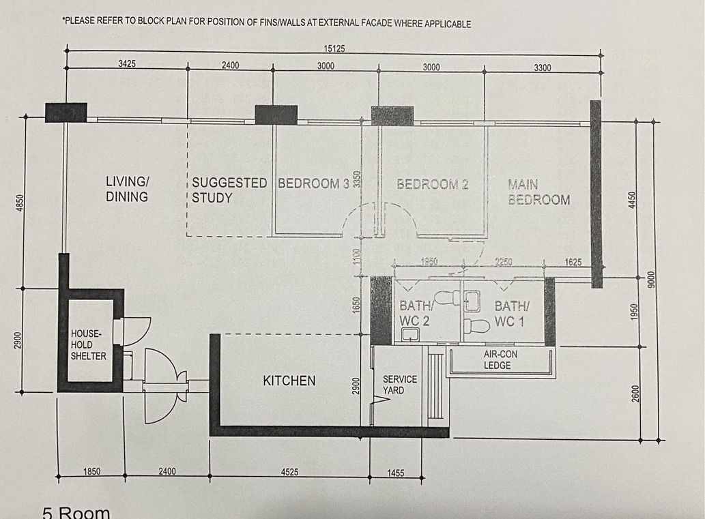

# Floor Plan

Source: HDB 5-room layout sheet — [assets/floor-plan-original.jpg](assets/floor-plan-original.jpg).
Machine-readable version used by Blender: [`blender/data/floor_plan.json`](../blender/data/floor_plan.json). Keep both in sync.

## Dimensions printed on the plan (mm)

- **Top (façade), left → right:** 3425 · 2400 · 3000 · 3000 · 3300 = **15125**
- **Right side, top → bottom:** 4450 · 1950 · 2600 = **9000**
- **Left side, top → bottom:** 4850 · 2900 = 7750
- **Bottom, left → right:** 1850 · 2400 · 4525 · 1455
- **Middle verticals:** Bedroom depth 3350 · corridor 1100 · 1650 (to kitchen) · kitchen depth 2900
- **Bathroom row:** 1950 (Bath 2) · 2250 (Bath 1) · 1625 (to façade)

## Coordinate system
Origin `(0,0)` is the top-left outer corner of the living room on the drawing. `x` goes right, `y` goes down the page. Units mm.

## Rooms

Values with **~** were scaled from the photo rather than read from a printed dimension — **approximate, verify on site with a tape measure**.

| Room | x from–to | y from–to | Size (approx) | Notes |
|---|---|---|---|---|
| Living/Dining | 0–3425 (+ dining hall 3425–8550) | 0–~4720 (hall ~3350–~6000) | — | Open plan; flows into study, foyer and kitchen |
| Suggested Study | 3425–5825 | 0–3350 | 2.40 × 3.35 m | Dashed walls on plan = optional, can be left open to living |
| Bedroom 3 | 5825–8825 | 0–3350 | 3.00 × 3.35 m | Door from corridor |
| Bedroom 2 | 8825–11825 | 0–3350 | 3.00 × 3.35 m | Door from corridor |
| Main Bedroom | 11825–15125 | 0–4450 | 3.30 × 4.45 m | Door from corridor end; en-suite Bath 1 |
| Corridor | ~8550–11825 | 3350–4450 | 1.1 m wide | Serves Bed 2, Bed 3, Main, Bath 2 |
| Bath/WC 2 (common) | ~9170–11160 | 4450–~6380 | ~1.95 × 1.95 m | Door from corridor |
| Bath/WC 1 (main) | ~11160–13570 | 4450–~6380 | ~2.25 × 1.95 m | Door from main bedroom |
| Air-con ledge | ~10770–13860 | ~6380–~7250 | — | Outdoor condenser units |
| Kitchen | ~4100–~8530 | ~6000–~8900 | ~4.5 × 2.9 m | Top edge dashed = can be open to dining |
| Service Yard | ~8530–~9980 | ~6380–~8900 | ~1.45 × 2.5 m | Laundry; door from kitchen |
| Household Shelter | ~-230–~1620 | ~4720–~7680 | ~1.6 × 2.7 m (int.) | Reinforced concrete — **cannot be hacked or drilled** |
| Entrance / Foyer | ~1620–~4100 | ~4720–~7680 | ~2.4 m wide | Main door + gate on bottom edge |

## Structural notes
- Dark filled blocks on the façade (at roughly x ≈ 0, 5900, 9200 and the right edge) are columns/fins — structural, cannot be removed.
- The thick block between kitchen and Bath 2 (~x 8550–9170) is likely a structural wall / service duct.
- Household shelter walls, door and ceiling must not be altered (SCDF rules).
- Note on plan: *"Please refer to block plan for position of fins/walls at external façade where applicable."*

## Assumptions used in the 3D model
- Ceiling height 2600 mm.
- External walls 200 mm, internal 150 mm, shelter 250 mm.
- Doors 900 × 2100 mm (main door 1000 mm). Windows: sill 900 mm, head 2100 mm.
